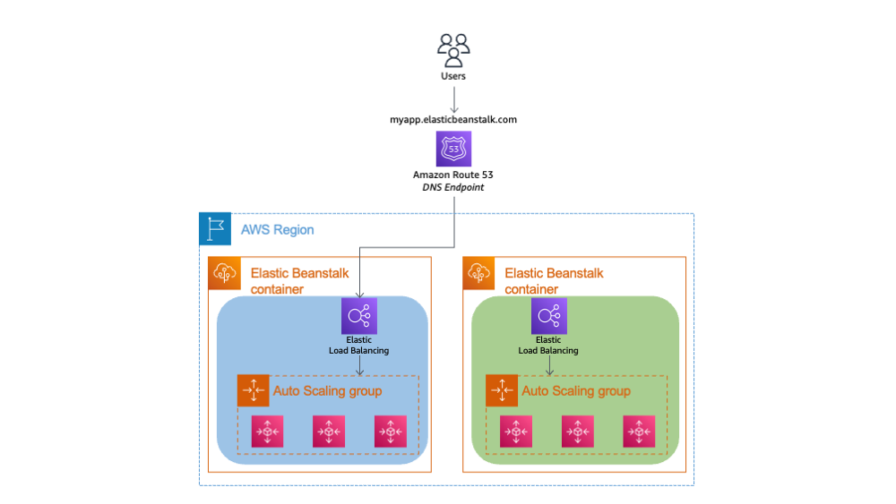

# Elastic Beanstalk

## Назначение AWS Elastic Beanstalk

**AWS Elastic Beanstalk** — это сервис, упрощающий развёртывание и управление веб-приложениями в облаке Amazon Web Services (AWS). Он позволяет загрузить исходный код приложения, выбрать программную платформу и настроить параметры окружения, после чего автоматически создаёт и управляет необходимыми облачными ресурсами.

Elastic Beanstalk поддерживает, в частности, Java, .NET, PHP, Node.js, Python, Ruby, Go и Docker. В зависимости от выбранной платформы и конфигурации сервис использует такие компоненты AWS, как Amazon EC2, группы безопасности, Auto Scaling и, при необходимости, Elastic Load Balancing. Для управления инфраструктурой используется AWS CloudFormation.

В Elastic Beanstalk следует различать два понятия:

- **Application (приложение)** — логическая сущность, объединяющая приложение и его версии.
- **Environment (окружение)** — совокупность облачных ресурсов, на которых развёрнута определённая версия приложения и которые обеспечивают её выполнение.

У одного приложения может быть несколько окружений. Например, окружение `production` используется для обслуживания пользователей, а окружение `staging` — для проверки новой версии перед её вводом в эксплуатацию.

Дополнительная информация: [AWS Elastic Beanstalk — документация](https://docs.aws.amazon.com/elasticbeanstalk/latest/dg/Welcome.html).

## Типы окружений и избыточность

В Elastic Beanstalk предусмотрено два основных типа веб-окружений:

- **Single-instance environment** — окружение с одним экземпляром Amazon EC2 без балансировщика нагрузки.
- **Load-balanced environment** — окружение с балансировщиком нагрузки и одним или несколькими экземплярами Amazon EC2. Количество экземпляров может изменяться в зависимости от настроек Auto Scaling.

В данной лабораторной работе **для простоты изучения процесса развёртывания и снижения стоимости используется окружение Single-instance, содержащее один экземпляр EC2**. Эта конфигурация позволяет сосредоточиться на создании окружений, развёртывании версий приложения и переключении трафика между ними.

Однако наличие одного экземпляра создаёт единую точку отказа (*Single Point of Failure, SPOF*). Если экземпляр EC2 перестанет работать, операционная система даст сбой или приложение окажется неработоспособным, пользователи могут временно потерять доступ к сервису. Автоматическое восстановление экземпляра не означает, что приложение останется доступным без перерыва.

Production-системам критически важно обеспечить надежность работы сервиса. Основным способом достижения этого является избыточность (redundancy).

**Избыточность (redundancy)** — это наличие дополнительных ресурсов или компонентов, способных продолжить выполнение работы при отказе основного компонента.

В production-системах, то есть системах, обслуживающих реальных пользователей, простой приложения может привести к потере заказов, нарушению бизнес-процессов и финансовым убыткам. Поэтому архитектуру обычно проектируют так, чтобы отказ отдельного компонента не приводил к полной недоступности приложения.

Например, вместо одного экземпляра EC2 можно использовать несколько экземпляров, размещённых как минимум в двух зонах доступности (*Availability Zones, AZ*), и балансировщик нагрузки. Он направляет запросы на работоспособные экземпляры, а Auto Scaling позволяет поддерживать необходимое количество экземпляров и при соответствующих настройках заменять отказавшие.

Избыточность решает несколько задач:

1. **Повышение доступности.** Отказ одного экземпляра не обязательно приводит к прекращению обслуживания пользователей, если остальные экземпляры продолжают работать.
2. **Уменьшение влияния отказов инфраструктуры.** Размещение компонентов в разных зонах доступности снижает зависимость от отказа одной зоны.
3. **Поддержка обслуживания и обновления.** При корректной конфигурации можно обновлять или заменять отдельные экземпляры без полной остановки приложения.
4. **Обработка изменения нагрузки.** При наличии нескольких экземпляров и подходящей конфигурации Auto Scaling система может увеличивать или уменьшать количество экземпляров в соответствии с нагрузкой.

При этом избыточность сама по себе не гарантирует бесперебойную работу. Если все экземпляры зависят от одной неисправной базы данных или другого общего компонента, приложение также может оказаться недоступным. Поэтому в production-архитектуре необходимо учитывать не только веб-серверы, но и все критически важные зависимости.

Избыточность увеличивает стоимость инфраструктуры и сложность её настройки. Уровень резервирования выбирают с учётом требований к доступности, допустимого времени простоя, нагрузки и бюджета.

Дополнительная информация: [Типы окружений Elastic Beanstalk](https://docs.aws.amazon.com/elasticbeanstalk/latest/dg/using-features-managing-env-types.html), [избыточность и доступность в AWS](https://docs.aws.amazon.com/whitepapers/latest/availability-and-beyond-improving-resilience/availability-with-redundancy.html).

## Стратегия Blue-Green Deployment

**Blue-Green Deployment** — это стратегия развёртывания программного обеспечения, при которой поддерживаются два отдельных окружения, позволяющих переключать обслуживание пользователей со старой версии приложения на новую.

Окружения условно обозначают следующим образом:

- **Blue** — окружение с текущей версией приложения, обслуживающей пользователей.
- **Green** — окружение, в котором подготовлена новая версия приложения.



Названия Blue и Green являются условными: они не определяют конкретные настройки облачной инфраструктуры.

Развёртывание новой версии выполняется в несколько этапов.

1. **Исходное состояние.** Окружение Blue работает и обслуживает пользовательские запросы.
2. **Подготовка нового окружения.** Создаётся окружение Green с необходимой конфигурацией.
3. **Развёртывание новой версии.** В окружение Green загружается новая версия приложения.
4. **Проверка.** Новая версия тестируется отдельно, до переключения основного пользовательского трафика.
5. **Переключение.** После успешной проверки выполняется переключение адресов окружений, чтобы пользователи начали обращаться к новой версии.
6. **Контроль результата.** Проверяются доступность приложения, его работоспособность и корректность обслуживания запросов.

В AWS Elastic Beanstalk для этой задачи предусмотрена операция **Swap environment URLs**. Она меняет CNAME-адреса двух окружений, направляя обращения к прежнему адресу рабочего окружения на новую версию приложения.

Переключение адресов не следует считать гарантированно мгновенным для всех пользователей: DNS-резолверы и клиенты могут некоторое время использовать закэшированные записи. После переключения необходимо проверить приложение и не удалять прежнее окружение до завершения проверки и учёта распространения DNS-изменений.

Если новая версия работает некорректно, сохранение прежнего окружения позволяет вернуть обслуживание к предыдущей версии. Такой возврат упрощает восстановление, но его успешность зависит от состояния инфраструктуры, совместимости данных и того, какие изменения успела выполнить новая версия приложения.

Подробное описание механизма: [Blue/Green deployments with Elastic Beanstalk](https://docs.aws.amazon.com/elasticbeanstalk/latest/dg/using-features.CNAMESwap.html).

## Blue-Green Deployment и высокая доступность — не одно и то же

Важно различать две цели:

- **Blue-Green Deployment** помогает безопаснее вводить новые версии приложения и упрощает возврат к предыдущей версии.
- **Высокая доступность (High Availability)** позволяет продолжать обслуживать пользователей при отказах отдельных компонентов системы.

Эти подходы дополняют друг друга, но не заменяют друг друга.

В рамках Blue-Green Deployment можно создать два окружения, каждое из которых содержит только один экземпляр EC2. Это позволяет развернуть новую версию отдельно от рабочей и переключить трафик после проверки. Однако после переключения активное окружение по-прежнему может зависеть от одного экземпляра, отказ которого приведёт к недоступности приложения до восстановления.

Следовательно, наличие двух окружений во время развёртывания не означает, что приложение постоянно обладает высокой доступностью.

В production-системах Blue-Green Deployment часто сочетают с балансировщиком нагрузки, несколькими экземплярами приложения, размещёнными в разных зонах доступности, и резервированием других критически важных компонентов.

## Работа с данными при смене версии приложения

При использовании Blue-Green Deployment необходимо отдельно учитывать состояние данных.

Если обе версии приложения используют одну базу данных, новая версия должна сохранять совместимость с текущей схемой и данными, пока старая версия ещё может обслуживать запросы. Несовместимое изменение схемы базы данных способно нарушить работу одной из версий даже при успешном переключении окружений.

Если используются отдельные базы данных, необходимо определить порядок переноса данных, согласования изменений и переключения приложения. Простое создание копии базы данных не гарантирует согласованности данных между двумя окружениями.

На практике для безопасного обновления часто применяют поэтапную миграцию схемы: сначала вносят обратно совместимые изменения, затем развёртывают новый код и только после проверки удаляют элементы, необходимые старой версии.

В данной лабораторной работе используется простое PHP-приложение без базы данных. Поэтому миграция данных не входит в практическую часть, однако при проектировании реальных систем этот вопрос должен рассматриваться отдельно.

## Ограничения лабораторной модели

В лабораторной работе используется Single-instance environment, поскольку для демонстрации Blue-Green Deployment достаточно двух отдельных окружений с одним экземпляром EC2 в каждом.

Это упрощение позволяет изучить основные операции:

- создание и настройку окружения Elastic Beanstalk;
- загрузку новой версии приложения;
- подготовку и проверку второго окружения;
- переключение URL окружений;
- проверку результата и возврат к предыдущей версии.

При этом работа **не предназначена для демонстрации промышленной отказоустойчивости**. В ней не исследуются балансировка нагрузки, масштабирование нескольких экземпляров, размещение в нескольких зонах доступности и отказоустойчивость базы данных.

Полученные результаты следует рассматривать как демонстрацию процесса развёртывания и переключения версий, а не как доказательство готовности архитектуры к эксплуатации в production-среде.

## Практическая часть

1. Войдите в веб-консоль AWS.
2. Откройте сервис Elastic Beanstalk в регионе Seoul (ap-northeast-2).
3. Создайте на локальном компьютере первую версию `index.php` (код прилагается ниже) и упакуйте его в ZIP-архив. Не используйте каталогов, `index.php` должен быть в корневом каталоге ZIP-архива.
4. Создайте новое веб-приложение Beanstalk:

   **Шаг 1**:
   * *Environment tier*: Web server environment
   * *Application information*, Application name: `<группа>-<фамилия>`
   * *Environment information*, Environment name: `<группа>-<фамилия>-prod`
   * *Platform*, Platform: PHP
   * *Application code*: Upload your code
   * *Application code*, Version label: v1
   * *Application code*, Source code origin: Local file, выбрать ZIP-архив
   * *Presets*, Configuration presets: single Instance (free tier eligible)

   **Шаг 2**:
   * Service role: Use an existing service role
   * Existing service roles: выберите любую существующую роль
   * EC2 key pair: Не выбирать
   * EC2 instance profile: выберите любую существующую роль

   **Шаг 3**:
   * *Virtual Private Cloud (VPC)*, VPC: выбрать VPC
   * *Instance settings*, Public IP address: проставить Activated
   * *Instance subnets*: выберите все подсети
   * *Database subnets*: оставить не заполненным
   * *Enable database*: не включать

   **Шаг 4**
   * *Instances*, EC2 security groups: default

   **Шаг 5**
   * *Monitoring*, Health reporting, System: Basic
   * *Managed platform updates*, Managed updates: снять Activated

5. Дождитесь запуска окружения и скопируйте созданное доменное имя.
6. Войдите в сервис Route 53, в hosted-зону `kit-imi.info` и создайте CNAME-запись для доменного имени приложения (без `http://`).
7. Проверьте работу веб-приложения в браузере по созданному доменному имени и протоколу HTTP.
8. На локальном компьютере обновите код приложения и ZIP-архив.
9. Откройте созданное окружение (environment) и склонируйте новое окружение (Actions, Clone environment). Задайте название `<группа>-<фамилия>-staging` и выберите существующую роль.
10. Дождитесь запуска окружения и загрузите новую версию кода (Upload and deploy). Выберите новый zip-архив и укажите новую версию приложения.
11. Проверьте работу новой версии в staging-окружении открыв его доменное имя.
12. Обменяйте доменные имена окружений: Actions, Swap environment domain, выберите prod-окружение.
13. Проверьте работу новой версии приложения в браузере по созданному в Route 53 доменному имени. Если всё сделано правильно, то пользователь по доменному имению в Route 53 должен увидеть новую версию приложения.

Код приложения:

**index.php**:
```php
<!DOCTYPE html>
<html>
<head>
  <meta charset="utf-8">
  <title>Elastic Beanstalk Lab!</title>
</head>
<body>
  <h1>Welcome!</h1>
  <p>Application version: v1</p>
  <p>Server time is <?php echo date("h:i:sa"); ?></p>
</body>
```

Измененный код приложения:

**index.php**:
```php
<!DOCTYPE html>
<html>
<head>
  <meta charset="utf-8">
  <title>Лабораторная работа Elastic Beanstalk!</title>
</head>
<body>
  <h1>Добро пожаловать!</h1>
  <p>Версия приложения: v2</p>
  <p>Время на сервере <?php echo date("h:i:sa"); ?></p>
</body>
```

Ссылки: [https://aws.amazon.com/ru/elasticbeanstalk/](https://aws.amazon.com/ru/elasticbeanstalk/)
